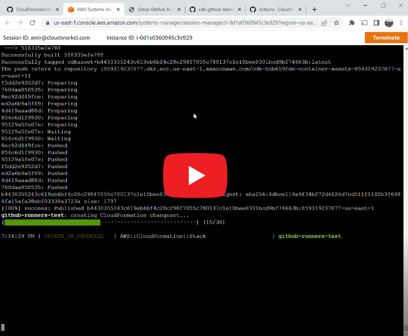

# GitHub Self-Hosted Runners CDK Constructs

[][7]
[][6]
[][8]
[][11]
[][12]

[][20]

Use this CDK construct to create ephemeral [self-hosted GitHub runners][1] on-demand inside your AWS account.

* 🛡️ Battle tested in production since 2022, from small teams to large organizations
* 📈 Scales to hundreds of runner types and as many runners as your AWS quotas allow, with serverless orchestration
* 🧩 Easy to configure GitHub integration with a web-based interface
* 🧠 Customizable runners with decent defaults
* 🏃🏻 Multiple runner configurations controlled by labels
* 🔐 Everything fully hosted in your account
* 🔃 Automatically updated build environment with latest runner version

Self-hosted runners in AWS are useful when:

* You need easy access to internal resources in your actions
* You want to pre-install some software for your actions
* You want to provide some basic AWS API access (but [aws-actions/configure-aws-credentials][2] has more security controls)
* You are using GitHub Enterprise Server (3.10 or newer, as runners are registered with [just-in-time configurations](https://docs.github.com/en/actions/security-for-github-actions/security-guides/security-hardening-for-github-actions#using-just-in-time-runners))

Ephemeral (or on-demand) runners are the [recommended way by GitHub][14] for auto-scaling, and they make sure all jobs run with a clean image. Runners are started on-demand. You don't pay unless a job is running.

## Documentation

Everything you need is on **[ghr.cloudsnorkel.com][21]**, with code in TypeScript, Python, Java, C# and Go.

* [Getting Started](https://ghr.cloudsnorkel.com/guide/getting-started)
* [Providers](https://ghr.cloudsnorkel.com/guide/providers)
* [Customizing](https://ghr.cloudsnorkel.com/guide/customizing)
* [Security](https://ghr.cloudsnorkel.com/guide/security)
* [Compliance](https://ghr.cloudsnorkel.com/guide/compliance)
* [Monitoring](https://ghr.cloudsnorkel.com/guide/monitoring)
* [Cost](https://ghr.cloudsnorkel.com/guide/cost)
* [Troubleshooting](https://ghr.cloudsnorkel.com/guide/troubleshooting)
* [API Reference](https://ghr.cloudsnorkel.com/api/)

## Demo

## Getting Help

Need help? We're here for you!

* 💬 **GitHub Discussions**: Ask questions, share ideas, or get help from the community by opening a [discussion][18]
* 🐛 **GitHub Issues**: Report bugs or request features by opening an [issue][16]
* 💬 **Discord**: Join our [Discord community][20] for real-time help and discussions

## Contributing

If you use and love this project, please consider contributing.

1. 🪳 If you see something, say something. [Issues][16] help improve the quality of the project.
   * Include relevant logs and package versions for bugs.
   * When possible, describe the use-case behind feature requests.
1. 🛠️ [Pull requests][17] are welcome.
   * Run `npm run build` before submitting to make sure all tests pass.
   * Allow edits from maintainers so small adjustments can be made easily.
1. 💵 Consider [sponsoring][15] the project to show your support and optionally get your name listed below.

## Sponsors

Thanks to our generous sponsors who helped make this project possible!

<table>
  <tr>
    <td align="center">
      <a href="https://github.com/threat-down">
        
         
        <b>ThreatDown</b>
      </a>
    </td>
    <td align="center">
      <a href="https://github.com/magicbell">
        
         
        <b>MagicBell</b>
      </a>
    </td>
    <td align="center">
      <a href="https://github.com/fragment-dev">
        
         
        <b>Fragment</b>
      </a>
    </td>
    <td align="center">
      <a href="https://github.com/qnicondavid">
        
         
        <b>Nicon-David Milandru</b>
      </a>
    </td>
    <td align="center">
      <a href="https://github.com/andresionek91">
        
         
        <b>Andre Sionek</b>
      </a>
    </td>
  </tr>
</table>

## Other Options

1. [github-aws-runners/terraform-aws-github-runner][3] if you're using Terraform
2. [actions/actions-runner-controller][4] if you're using Kubernetes

[1]: https://docs.github.com/en/actions/hosting-your-own-runners/about-self-hosted-runners
[2]: https://github.com/marketplace/actions/configure-aws-credentials-action-for-github-actions
[3]: https://github.com/github-aws-runners/terraform-aws-github-runner
[4]: https://github.com/actions/actions-runner-controller
[6]: https://pypi.org/project/cloudsnorkel.cdk-github-runners
[7]: https://www.npmjs.com/package/@cloudsnorkel/cdk-github-runners
[8]: https://central.sonatype.com/artifact/com.cloudsnorkel/cdk.github.runners/
[9]: https://docs.github.com/en/developers/apps/getting-started-with-apps/about-apps
[10]: https://docs.github.com/en/authentication/keeping-your-account-and-data-secure/creating-a-personal-access-token
[11]: https://pkg.go.dev/github.com/CloudSnorkel/cdk-github-runners-go/cloudsnorkelcdkgithubrunners
[12]: https://www.nuget.org/packages/CloudSnorkel.Cdk.Github.Runners/
[14]: https://docs.github.com/en/actions/hosting-your-own-runners/autoscaling-with-self-hosted-runners#using-ephemeral-runners-for-autoscaling
[15]: https://github.com/sponsors/CloudSnorkel
[16]: https://github.com/CloudSnorkel/cdk-github-runners/issues
[17]: https://github.com/CloudSnorkel/cdk-github-runners/pulls
[18]: https://github.com/CloudSnorkel/cdk-github-runners/discussions
[20]: https://discord.gg/vdrTUTqQKv
[21]: https://ghr.cloudsnorkel.com
