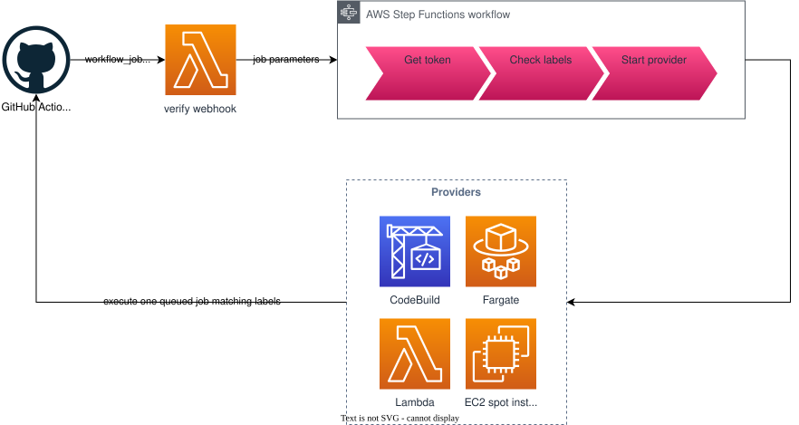

# Architecture

This is the original architecture diagram from the first version of this project. It is still technically correct, but
we have since added a few more features that run outside of this loop on a schedule or in Lambda in response to events
in a queue. Stolen runner detector, webhook redelivery, warm runners, and idle runner reaper all run in the background.
The diagram also doesn't cover runner image building which runs on schedule. The diagram needs a refresh, but it is
still a good overview of the main loop of the system.

